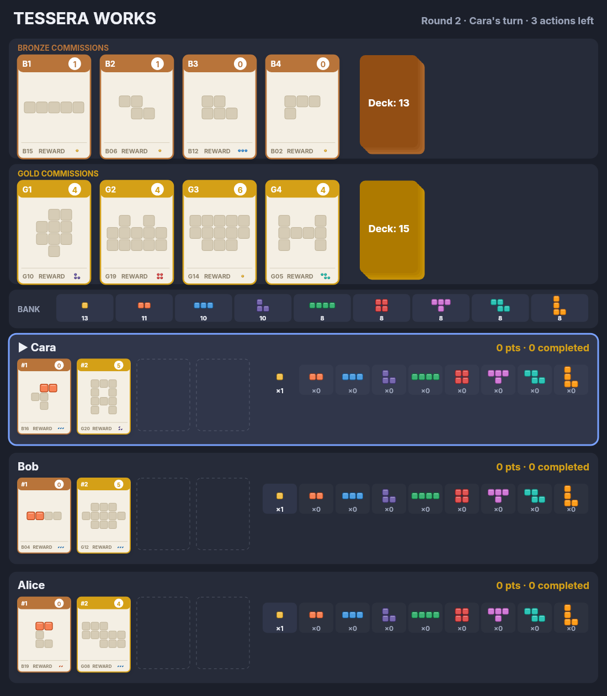
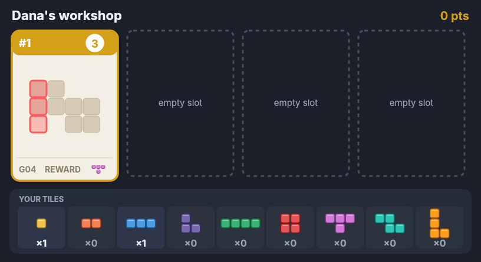
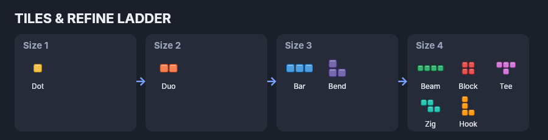

# Tessera Works: a Discord puzzle-building game

Tessera Works is an original polyomino puzzle-building game for 1–4 players, played entirely inside Discord.
You take commission puzzles, fill them with tiles, and each finished puzzle pays out points plus a new tile.
That grows your workshop, so you can finish bigger puzzles faster.



## Features

- **Shared table image** in the channel shows the market, bank and every player's workshop. It refreshes after every action and moves to the bottom of the channel, with a ping, when the turn passes.
- **Private control panel** (ephemeral) for each player, with buttons and dropdowns for every action.
- **Visual placement**: a ghost tile you can move with arrows, rotate, mirror, or snap to the next spot where it fits. Green means it fits and red means it doesn't.
- **Flurry builder**: queue one tile per puzzle, undo, then resolve everything as one action.
- 42 original puzzles (20 Bronze, 22 Gold) and 9 tile types.
- Games are saved to `data/games.json`, so they survive a bot restart.



## Rules (short)

| | |
|---|---|
| **Setup** | Each player starts with a Dot (1) and a Duo (2). Four Bronze and four Gold puzzles are face-up. |
| **Turn** | 3 actions, and repeats are allowed. |
| **Draw** | Take a Dot. |
| **Refine** | Return a tile; take one exactly 1 size larger, or any tile of the same or smaller size. |
| **Commission** | Take a face-up puzzle (it gets refilled) or blind-draw a deck top. Hold at most 4. |
| **Fit** | Place one tile into one of your puzzles. Rotating and mirroring are allowed; tiles can't overlap or stick out. |
| **Flurry** | Once per turn: place one tile in each of any number of your puzzles, for one action. |
| **Complete** | Score the points, take back all your tiles, gain the reward tile. Finishing 2+ puzzles in one action gives +1. |
| **End** | When the Gold deck empties, or after round 14, finish the round and then play one final round. Unfinished puzzles cost −1 (Bronze) or −2 (Gold). |



`/tessera rules` shows the full rules in Discord.

## Setup

1. Create an application at <https://discord.com/developers/applications>, add a **Bot**, and copy its token.
2. Invite it with the `bot` and `applications.commands` scopes and the permissions **Send Messages**, **Attach Files**, **Embed Links**, **Read Message History** and **Manage Messages**. The bot needs Manage Messages to delete its old table message when it reposts the table.
3. Install and run (Node 20.6+):

```bash
npm install
```

```bash
cp .env.example .env   # then put your token in .env (and optionally GUILD_ID)
```

```bash
npm start
```

Set `GUILD_ID` to register the command in your server instantly. Global registration can take up to an hour to appear.

## Commands

| Command | What it does |
|---|---|
| `/tessera new` | Open a lobby in this channel (Join / Leave / Start / Cancel buttons). |
| `/tessera play` | Open your private control panel. The **Open my panel** button under the table does the same. |
| `/tessera board` | Re-post the table at the bottom of the channel. |
| `/tessera rules` | Show the rules and the tile reference. |
| `/tessera end` | End the game early (host or moderators). |

The game runs one game per channel; use a different channel for a parallel game.

## Development

```bash
npm test
```

The tests include an engine fuzz test that plays 40 random full games and checks that every game ends and no tiles are created or lost. They also drive the bot's handlers with mock Discord interactions and run discord.js payload validation.

```
src/engine/pieces.js   tile shapes, bank supply, rotations/mirrors
src/engine/puzzles.js  the puzzle set (edit the ASCII art to add your own)
src/engine/game.js     rules engine (pure, no Discord dependency)
src/render.js          PNG rendering with @napi-rs/canvas
src/bot.js             Discord commands, panels and interaction flow
src/rules.js           rules text shown in Discord
```

Fonts: Inter (SIL OFL 1.1), bundled in `assets/fonts`.
